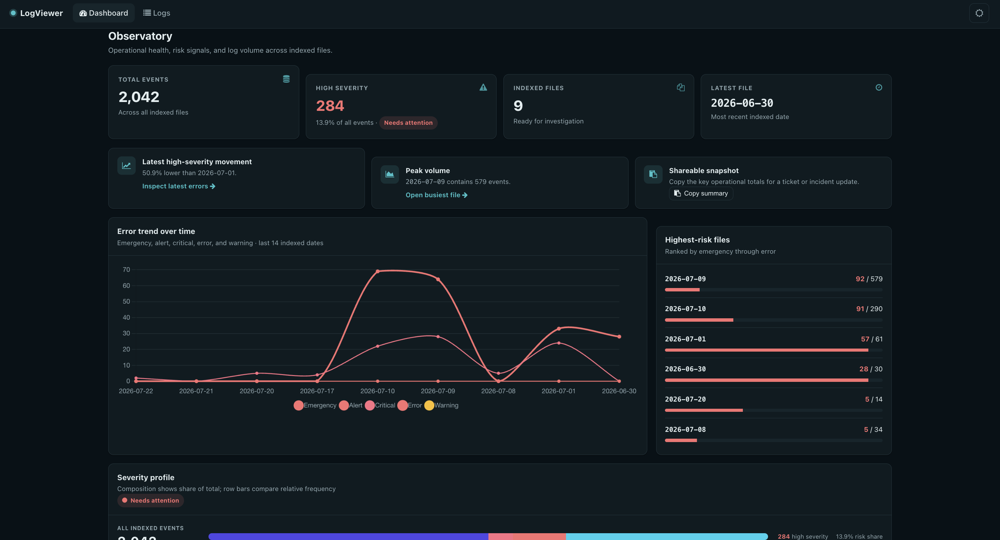
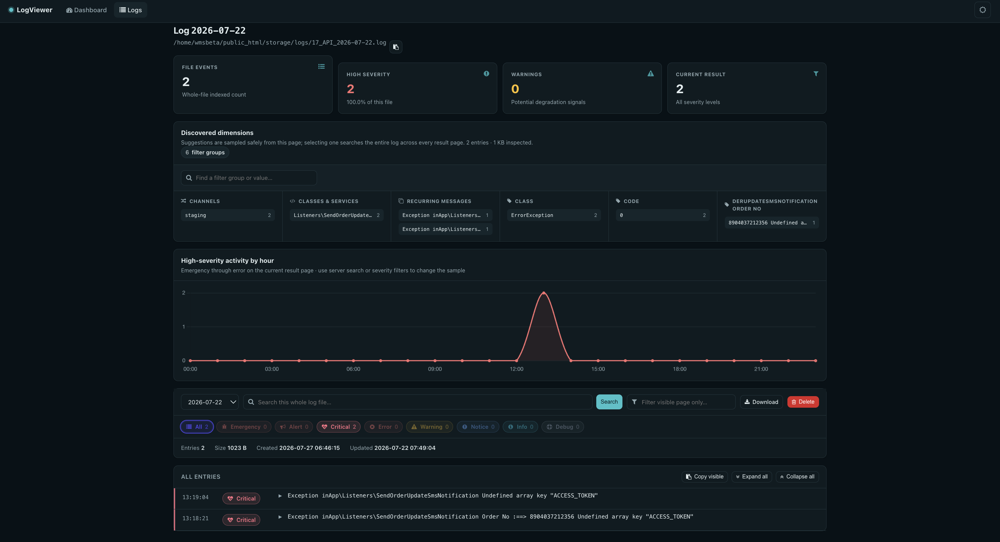
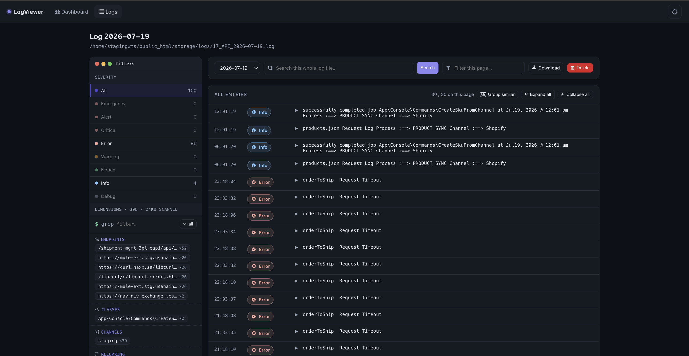
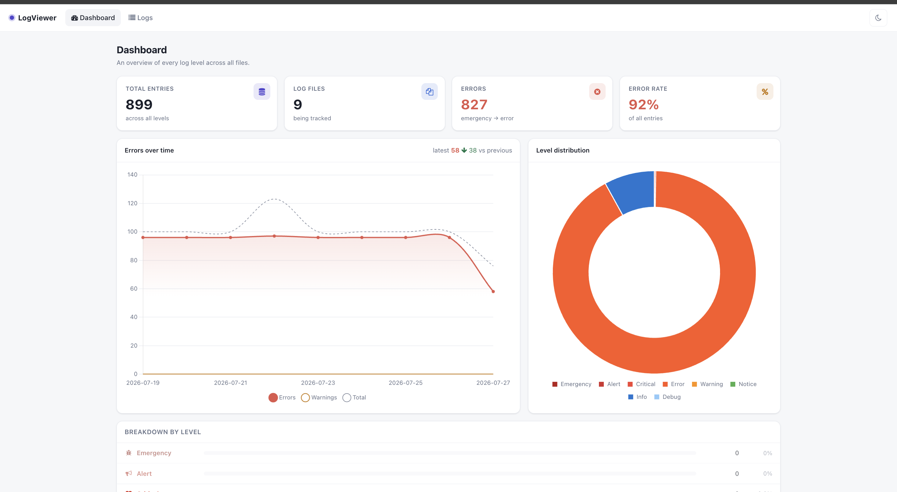
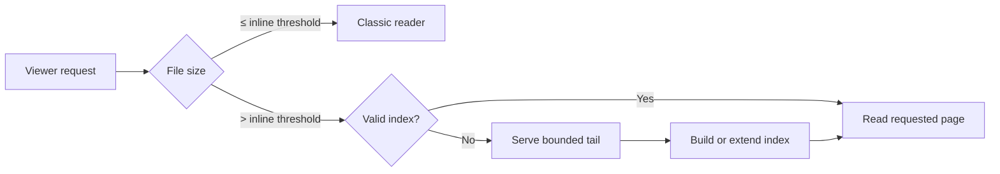
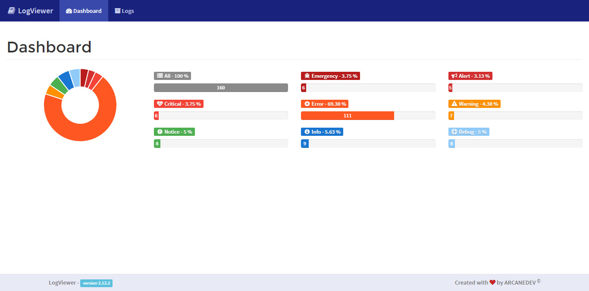
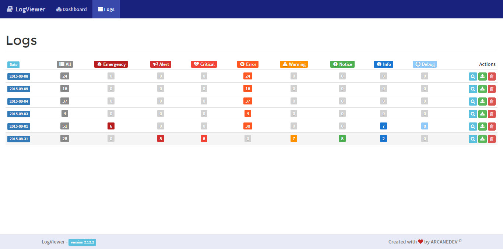
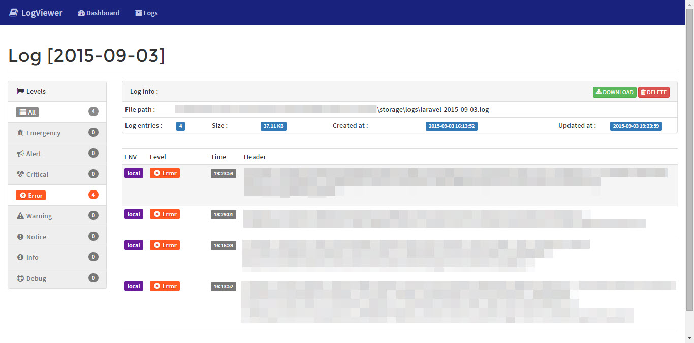

<div align="center">

# LogViewer for Laravel

### Investigate Laravel logs without loading giant files into memory.

Searchable log streams, bounded-memory indexing, operational analytics, and two modern opt-in themes—without a frontend build step.

[](https://github.com/iYogesharma/logviewer-laravel/releases)
[](https://github.com/iYogesharma/logviewer-laravel/actions)
[](#requirements)
[](#requirements)
[](LICENSE.md)

**A fork of [ARCANEDEV/LogViewer](https://github.com/ARCANEDEV/LogViewer) · current release line `2.x`**

[Quick start](#quick-start) · [Themes](#themes) · [Large files](#large-file-streaming) · [Upgrade guide](UPGRADE.md) · [Changelog](CHANGELOG.md)

<br>



<sub>Observatory theme · see [all screenshots](#themes)</sub>

</div>

---

## Why this fork?

This package is a fork of [ARCANEDEV/LogViewer](https://github.com/ARCANEDEV/LogViewer). It keeps the original `Arcanedev\LogViewer\` namespace, configuration keys, routes and public API, so it installs as a drop-in replacement — see [Migrating from `arcanedev/log-viewer`](#migrating-from-arcanedevlog-viewer).

Traditional log viewers eventually hit the same wall: opening or searching a large file requires reading the whole thing into memory. Version 2 introduces a binary sidecar index and reads only the entries needed for the current request.

| Capability | What it provides |
|---|---|
| Bounded-memory streaming | Paginate and search multi-megabyte logs without a whole-file read |
| Safe cold start | Serve a bounded tail while an index is warming |
| Incremental indexing | Append new log entries without rebuilding unchanged data |
| Format drivers | Classic Laravel line logs and JSON logs behind one interface |
| Operational UI | Error trends, severity health, pattern discovery, and whole-file searches |
| Familiar management | Date and level filters, downloads, opt-in deletion, localization, and API access |

## Requirements

- PHP `7.3` or newer
- Laravel `8.x` or newer
- JSON extension
- A writable index location when streaming is enabled

> The dependency matrix is intentionally broad. Validate your exact PHP/Laravel combination in CI before a production upgrade.

## Quick start

```bash
composer require iyogesharma/log-viewer:^2.0
```

<details>
<summary>Installing straight from GitHub instead</summary>

Add the repository to your application's `composer.json`, then require the package as usual:

```json
{
    "repositories": [
        {
            "type": "vcs",
            "url":  "https://github.com/iYogesharma/logviewer-laravel"
        }
    ]
}
```

```bash
composer require iyogesharma/log-viewer:^2.0
```

</details>

Publish configuration when you need to customize storage, streaming, routes, or themes:

```bash
php artisan vendor:publish --provider="Arcanedev\LogViewer\LogViewerServiceProvider"
```

Open the viewer at:

```text
/log-viewer
```

The default remains `bootstrap-5`, so upgrading does not silently switch the interface.

## Themes

Version 2 includes two self-contained themes. Both support automatic, light, and dark color modes and require no npm installation or asset compilation.

```php
// config/log-viewer.php
'theme' => 'observatory', // or 'console'
```

| | Observatory | Console |
|---|---|---|
| Best for | Support and operations teams | Developers and message-first debugging |
| Dashboard | Error trends, risk signals, severity health, highest-risk files | Compact level distribution |
| Log files | Non-scrolling investigation list | Dense level-count grid |
| Investigation | Dynamic dimensions and whole-file pattern searches | Server search and visible-page filtering |
| Details | Conditional stack/context expansion | Conditional stack/context expansion |
| Copy tools | Summaries, visible entries, complete entries | Context and entry copy actions |

### Observatory

The Observatory theme turns indexed counts into support-oriented signals ([dashboard screenshot above](#logviewer-for-laravel)):

- High-severity movement across indexed dates
- Peak-volume and highest-risk files
- Hourly high-severity activity for the current result set
- Dynamically discovered URLs, routes, processes, channels, model IDs, classes, services, and JSON fields
- Whole-file server searches that remain active across pagination
- Strict analysis budgets so UI discovery never becomes a second log parser

Pattern suggestions are sampled from the current page, but selecting one searches the complete selected log.



### Console

The Console theme keeps the interface dense and direct:

- Whole-file search and level filters
- Date switching and visible-page filtering
- Message-first log rows
- Conditional stack and context details
- Download, opt-in delete, copy, and pagination controls





Both themes apply the saved color mode before first paint to prevent light/dark flicker during navigation — the Console screenshots above show the same theme in dark and light modes.

## Large-file streaming

Streaming is enabled by default for files above the inline threshold:

```php
// config/log-viewer.php
'streaming' => [
    'enabled'               => true,
    'max-inline-bytes'      => 2 * 1024 * 1024,  // 2 MB
    'index-path'            => null,              // beside logs by default
    'tail-bytes'            => 25 * 1024 * 1024, // bounded cold-file fallback
    'max-build-concurrency' => 2,
],
```



### Warm indexes during deployment

```bash
php artisan log-viewer:index
```

Index one date:

```bash
php artisan log-viewer:index 2026-07-23
```

When logs live on a read-only or shared mount, configure a dedicated writable directory:

```php
'index-path' => storage_path('framework/log-viewer-indexes'),
```

Indexes are disposable caches. Source log files remain authoritative.

## Bounded UI analytics

Dynamic pattern discovery intentionally has hard limits:

- Current paginator page only
- At most 75 entries inspected
- Approximately 512 KB total analysis budget
- Capped header, context, and stack samples
- Capped dimension and value cardinality
- No full-file traversal from Blade

The interface shows the number of entries and bytes sampled. Applying a suggested value uses the normal server search route across the complete file.

## Log formats

The streaming registry supports:

- Classic Laravel/Monolog line logs
- JSON log records

Pattern discovery does not require JSON. It can infer useful values from route-like text, labeled fields, environments, messages, classes, services, and optional context data.

Custom formats can be added through the format-driver contract. Test representative production logs before enabling streaming globally.

## Configuration

The main options live in [`config/log-viewer.php`](config/log-viewer.php):

- Log storage path and filename pattern
- Locale
- Theme
- Route prefix and middleware
- Entries per page
- Formatter/driver
- Streaming threshold and index location
- Tail fallback and build concurrency
- Download and menu behavior
- Delete controls (`observatory` and `console` themes), disabled by default

### Delete controls

Log deletion is destructive and irreversible, so the delete buttons in the two v2 themes are **hidden by default**:

```php
'delete' => false,
```

Set it to `true` — or bind it to an environment variable — to show them:

```php
'delete' => (bool) env('LOG_VIEWER_ALLOW_DELETE', false),
```

This flag controls the UI of the `observatory` and `console` themes only. The `log-viewer::logs.delete` route stays registered, because the bootstrap themes still use it; apply route middleware if deletion must be forbidden outright.

Detailed package documentation remains available in:

1. [Installation and setup](_docs/1.Installation-and-Setup.md)
2. [Configuration](_docs/2.Configuration.md)
3. [Usage](_docs/3.Usage.md)
4. [Upgrading from 1.2.x](UPGRADE.md)

## Migrating from `arcanedev/log-viewer`

The namespace, facade, configuration keys, route names, views and published assets are unchanged, so switching packages is a Composer operation:

```bash
composer remove arcanedev/log-viewer
composer require iyogesharma/log-viewer:^2.0
```

Your existing `config/log-viewer.php` keeps working — merge the new `streaming` and `delete` keys when convenient. Existing `Arcanedev\LogViewer\` imports, `LogViewer::` facade calls and `log-viewer::` route names need no edits.

The one code change to check for: if your application implements the `Arcanedev\LogViewer\Contracts\LogViewer` contract itself, add the new `logForViewer($date)` method. See the [upgrade guide](UPGRADE.md).

## Upgrading to v2

Version 2 contains public-contract and runtime changes. Before deployment:

1. Merge the new configuration.
2. Update custom `LogViewer` contract implementations with `logForViewer($date)`.
3. Prepare a writable index directory.
4. Test representative line and JSON logs.
5. Warm large indexes if first-request latency matters.

See the complete [upgrade guide](UPGRADE.md), including opt-out and rollback instructions.

## Testing

```bash
vendor/bin/phpunit
```

The suite covers classic behavior, streaming indexes, format handling, PCRE safety, and real-route rendering for both modern themes.

## Localization

The package includes translations for Arabic, Bengali, Bulgarian, Chinese, Dutch, English, Estonian, French, German, Hungarian, Indonesian, Italian, Japanese, Korean, Malay, Persian, Polish, Portuguese, Romanian, Russian, Sinhala, Spanish, Swedish, Thai, Turkish, Ukrainian, and Uzbek.

## Legacy Bootstrap preview

<details>
<summary>Show the inherited Bootstrap interface</summary>





</details>

## Security

Please do not report security vulnerabilities through public issues. Contact the repository maintainer privately with reproduction details and affected versions.

## Credits

This fork builds on the original [ARCANEDEV LogViewer](https://github.com/ARCANEDEV/LogViewer) project and its contributors, and remains MIT licensed.

- [ARCANEDEV](https://github.com/arcanedev-maroc) — original author
- [Yogesh Sharma](https://github.com/iYogesharma) — fork maintainer
- [All contributors](https://github.com/iYogesharma/logviewer-laravel/graphs/contributors)

## License

Released under the [MIT License](LICENSE.md).
